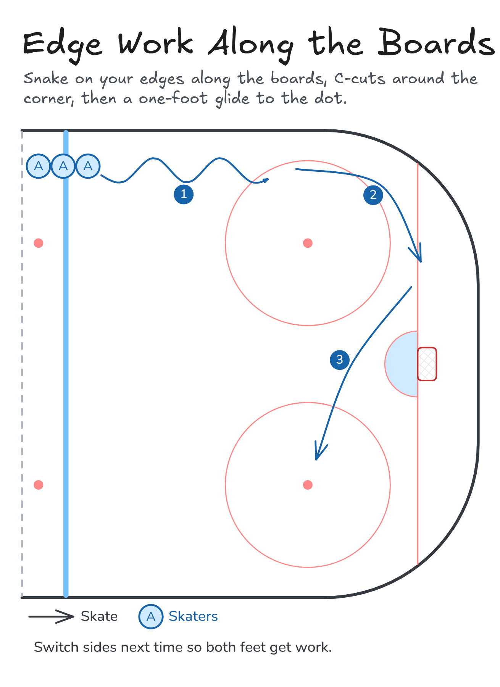

# Edge Work Along the Boards

Snake on your edges along the boards, C-cuts around the corner, then a one-foot glide to the dot.

**Tags:** `skating`

[All drills](../README.md) · [Drill page](edge-work-boards/) · [Animation](../media/edge-work-boards/edge-work-boards-anim.html) · [PNG](../media/edge-work-boards/edge-work-boards.png) · [Excalidraw](../media/edge-work-boards/edge-work-boards.excalidraw)

The drill page embeds the HTML animation. The PNG is the still diagram and the home-page thumbnail.

## Coaching points

- Knees bent, weight over the skate you're on.
- Snake: roll from inside edge to outside edge, don't step.
- C-cuts: push out in a C and pull back under you, one foot at a time.
- One-foot glide: arms out, hold it as long as you can.
- Head up the whole way.

## How it runs

1. One line at the blue line beside the boards.
2. Snake along the boards on inside and outside edges.
3. C-cuts around the corner to the goal line.
4. One-foot glide to the far faceoff dot, then skate back up the middle.
5. Next skater goes when the one ahead reaches the corner. Switch sides next time.

Open the Excalidraw file above in [Excalidraw](https://excalidraw.com) to change the diagram.

## Related drills

- [Edges: Cone Weave](cone-weave.md)
- [Backward C-Cuts](backward-c-cuts.md)
- [Tight Turns Around the Dots](tight-turns-dots.md)

