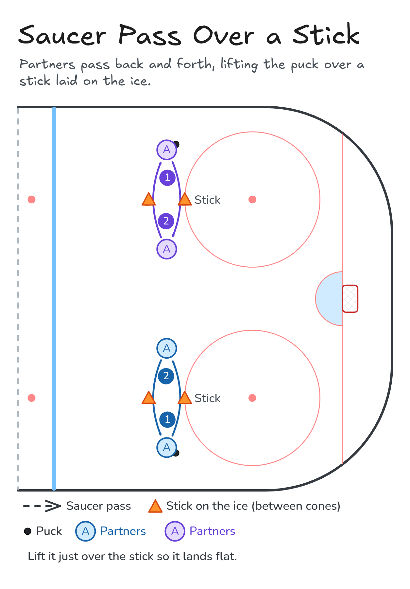

# Saucer Pass Over a Stick

Partners pass back and forth, lifting the puck over a stick laid on the ice.

**Tags:** `passing`

[All drills](../README.md) · [Drill page](saucer-pass-over-stick/) · [Animation](../media/saucer-pass-over-stick/saucer-pass-over-stick-anim.html) · [PNG](../media/saucer-pass-over-stick/saucer-pass-over-stick.png) · [Excalidraw](../media/saucer-pass-over-stick/saucer-pass-over-stick.excalidraw)

The drill page embeds the HTML animation. The PNG is the still diagram and the home-page thumbnail.

## Coaching points

- Start with the puck at the heel of your blade.
- Roll it to the toe and flick up a little.
- Small lift: just over the stick, so it lands flat.
- Catch it with a soft stick and cushion it.
- Forehand first, then backhand.

## How it runs

1. Partners stand about 20 feet apart with a stick laid flat on the ice between them.
2. Saucer pass over the stick to your partner.
3. Catch it flat and saucer it back.
4. Do 10 forehand, then 10 backhand.

Open the Excalidraw file above in [Excalidraw](https://excalidraw.com) to change the diagram.

## Related drills

- [Stationary Partner Passing](stationary-partner-passing.md)
- [Rondo Passing Progressions](rondo-passing.md)
- [Triangle Passing on the Move](triangle-passing-on-the-move.md)

