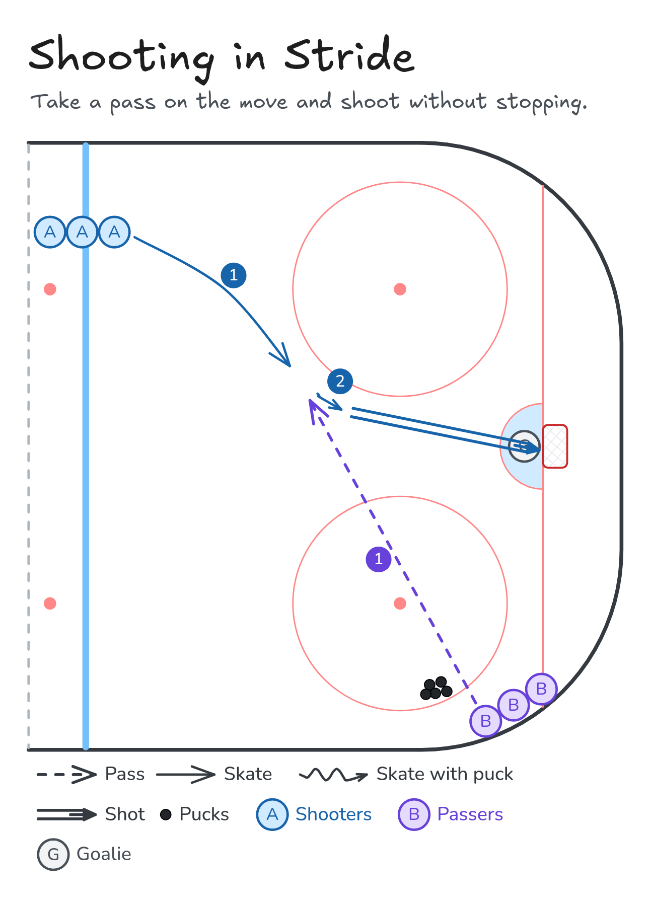

# Shooting in Stride

Take a pass on the move and shoot without stopping.

**Tags:** `half-ice`, `passing`, `shooting`

[All drills](../README.md) · [Drill page](shooting-in-stride/) · [Animation](../media/shooting-in-stride/shooting-in-stride-anim.html) · [PNG](../media/shooting-in-stride/shooting-in-stride.png) · [Excalidraw](../media/shooting-in-stride/shooting-in-stride.excalidraw)

The drill page embeds the HTML animation. The PNG is the still diagram and the home-page thumbnail.

## Coaching points

- Keep your feet moving. Don't stop to shoot.
- Stick on the ice, ready for the pass.
- Passer: lead the shooter, hit them in front of their body.
- Catch and release quickly. Aim for a corner.
- Follow your shot for a rebound.

## How it runs

1. Shooters at the blue line, passers with pucks in the corner.
2. The shooter skates into the high slot.
3. The passer leads them with a pass.
4. Shoot in stride without stopping.
5. Shooter goes to the passer line, passer goes to the shooter line.

Open the Excalidraw file above in [Excalidraw](https://excalidraw.com) to change the diagram.

## Related drills

- [Give-and-Go to Shot](give-and-go-shot.md)
- [Backhand Shooting](backhand-shooting.md)
- [Three-Lane Wave Shooting](three-lane-wave-shooting.md)

